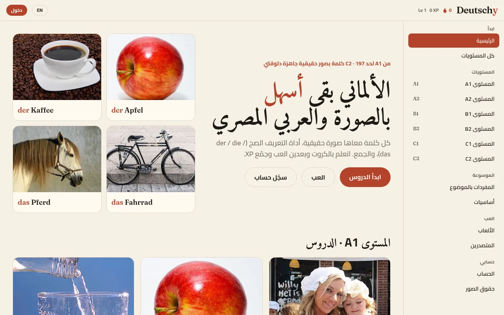
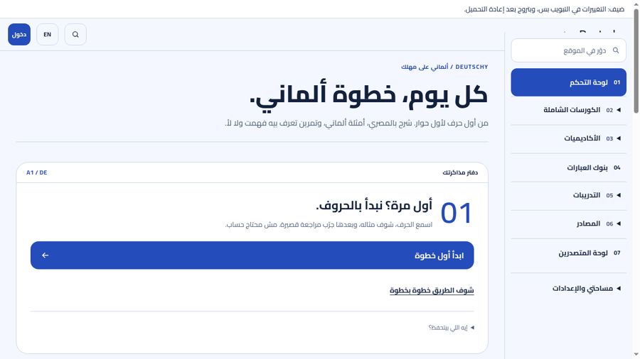
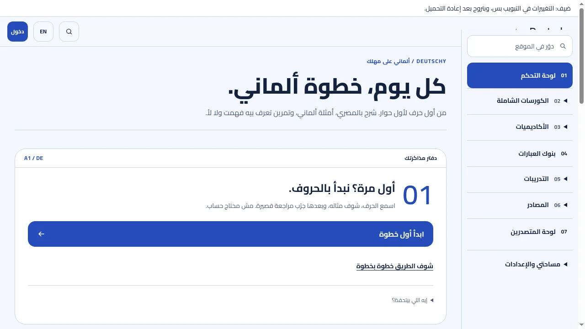
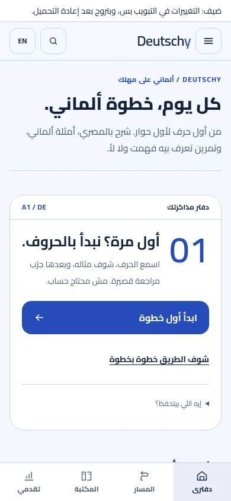

<div align="center">

# Deutschy

### Learn German from A1 to C2 — بالعامية المصرية

Lessons with real photos, five game modes, and every word explained in Egyptian Arabic.

[](https://deutschy.pages.dev)
[](https://nextjs.org)
[](https://hono.dev)
[](https://pages.cloudflare.com)

[](https://deutschy.pages.dev)

**[Start learning →](https://deutschy.pages.dev)**

</div>

---

## Live preview

Captured from the live guest experience on 18 November 2026, not from a mockup. The animated tour cycles through the home page, the lesson library and a family vocabulary lesson.

[](https://deutschy.pages.dev/)

| Desktop | Mobile |
| --- | --- |
|  |  |

[Browse lessons](https://deutschy.pages.dev/lessons/) · [Open the family lesson](https://deutschy.pages.dev/lessons/family/)

## What it is

- **All six CEFR levels** — the data model and navigation cover A1 through C2. The live home links to all six
  learning paths. These are practice paths, not an official complete curriculum or a placement result.
- **Lessons by level and topic** — every card carries a real photo, the article
  (der/die/das), the plural and an Egyptian Arabic translation.
- **Basics page** — greetings, numbers, weekdays, months, colours, `sein`, `haben`,
  articles.
- **Games hub** — flashcards, picture quiz, der/die/das, spelling and memory, with XP,
  levels, a day streak and a leaderboard.
- **Sign in with Google** — server-side OAuth in Hono with a signed HttpOnly session cookie.
- **Owner admin dashboard** at `/admin`, with a themes system.
- **Pronunciation** — natural voices through `/api/tts` when configured, otherwise the
  browser's German voice. Nothing plays automatically.

## Content rules

- Every word and Arabic translation is entered by hand in `data/vocab-source*.txt`.
- Every photo is a real photo from Wikimedia Commons with its license and author
  recorded in `data/vocab.json` and shown on `/credits`. Words without a clearly
  matching photo are left out until one is found (`data/pending-photos.json`).
- No audio files and no vocabulary counts are invented.

## Architecture

```
Next.js static export (src/app: levels, lessons, learn, games, leaderboard, account, admin)
  └─ /api/* ──► Hono on Cloudflare Pages Functions (functions/api/[[route]].ts)
        ├─ Google OAuth + signed HttpOnly session cookie
        ├─ /api/tts pronunciation endpoint
        └─ admin routes guarded to the owner account
```

## Develop

```bash
npm install
npm run dev          # local dev
npm run build        # static site -> ./out
npm run verify       # content integrity checks
```

Cloudflare Pages: build command `npm run build`, output directory `out`.

### Environment (Cloudflare Pages secrets)

`GOOGLE_CLIENT_ID`, `GOOGLE_CLIENT_SECRET`, `SESSION_SECRET`. Speech is OFF pending publication review;see [speech setup](docs/tts-setup.md) for server-only key slots,D1 backup/migration,quota gates and voice settings.

---

<div align="center">

Made with care by **Mohamed Alhinawi** · [deutschy.pages.dev](https://deutschy.pages.dev)

</div>
